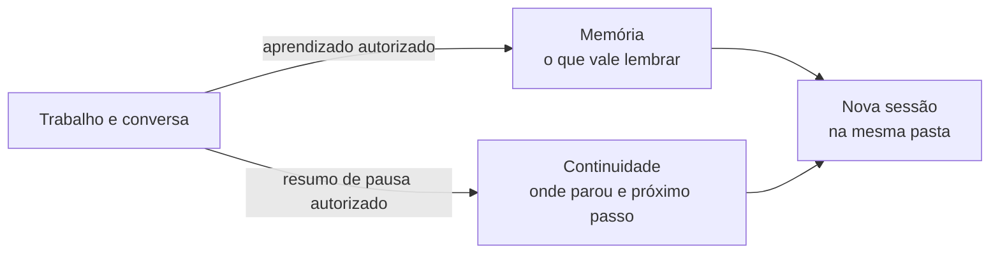

# Memória

Aqui ficam aprendizados e preferências que podem ajudar nos próximos trabalhos: seu jeito de escrever, um critério de revisão ou uma lição de um projeto. Você pode pedir ao agente para guardar, consultar ou corrigir um registro em linguagem comum.

Memória e continuidade têm papéis próximos, mas diferentes. A memória guarda o que vale lembrar em outros trabalhos. A [continuidade](<../01. SISTEMA/CONTINUIDADE.md>) guarda onde um trabalho parou, suas fontes e o próximo passo. A [lista de decisões](<../01. SISTEMA/DECISOES.md>) registra decisões duráveis e quando precisam ser revistas.

Em uma nova conversa, abra a mesma pasta e peça para retomar. O agente precisa ter acesso aos arquivos e consultar os registros pertinentes; uma conversa anterior, por si só, não garante que o contexto tenha sido salvo ou carregado.

## Como usar

- **Guardar:** “Lembra que prefiro revisar o roteiro antes de criar os slides.”
- **Consultar:** “O que já decidimos sobre este projeto? Mostra a fonte.”
- **Corrigir:** “Essa preferência mudou. Atualiza o registro e preserva a referência anterior.”
- **Pausar:** “Salva onde paramos e qual é o próximo passo para eu retomar depois.”

O agente registra ou atualiza o que você autorizou. Cada registro informa o que foi observado, de onde veio, a quem se aplica, quando foi confirmado e quando precisa de revisão. Separe proposta, inferência e aprendizado validado. Um aprendizado restrito a um projeto fica no contexto desse projeto. Não misture contexto de uma pessoa ou cliente com outro.

Contratos, fontes e resultados continuam em seus destinos próprios. A memória aponta para eles, sem virar outra fonte de verdade. Antes de usar uma informação antiga como decisão vigente, confira a fonte e o período a que ela se refere. Se houver conflito ou não houver evidência suficiente, deixe isso claro.

Uma revisão de entrega pode justificar atualizar a memória dentro da autorização dada. Repetir uma sugestão não a transforma em regra. Não copie credenciais, dados fiscais completos ou conversas inteiras para estes registros.
