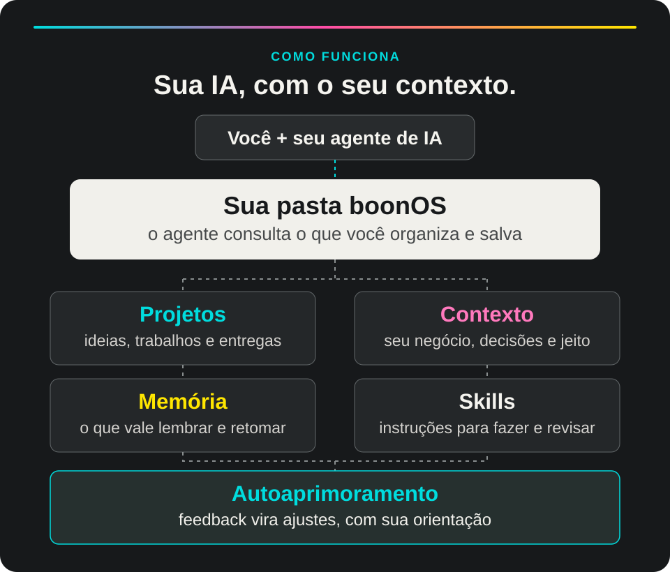

# boonOS Beta

Sua IA conhece a tarefa. O boonOS ajuda ela a conhecer **você, seu trabalho e o seu jeito de criar**.

É um sistema que reúne contexto, memória e skills em uma pasta sua. Você configura aos poucos, trabalha em projetos reais e retoma com o que ficou salvo. Foi criado pela BOON a partir do jeito que usamos IA no estúdio.

## Comece por aqui

Você precisa de um computador e de uma IA que trabalhe com arquivos. Recomendamos o **Codex** ou o **Claude Code**, com um plano pago para ter mais disponibilidade.

Abra o agente, copie e cole:

```text
Instale o boonOS pelo ZIP da branch principal. Extraia preservando os acentos, confira todos os arquivos e, se a verificação falhar, corrija antes de começar. Depois, me ajude a começar: https://github.com/studio-boon/boonOS
```

A IA prepara uma cópia para você e começa uma conversa sobre seu trabalho. Você pode partir de uma tarefa real ou configurar o sistema com mais calma. Não precisa saber comandos: acompanhe as perguntas e as permissões que aparecerem.

**Já tem o boonOS?** Abra a pasta que você já usa e peça para retomar. Para atualizar sem perder seu contexto, siga o [guia de atualização](<boonOS/06. GUIAS/01. INSTALAÇÃO/ATUALIZAR.md>).

<details>
<summary>Instruções para o agente que está instalando</summary>

Para uma nova instalação, baixe o [ZIP da versão atual](https://github.com/studio-boon/boonOS/archive/main.zip) da branch principal e extraia em uma pasta nova escolhida com a pessoa. O ZIP da branch contém uma pasta externa do repositório e, dentro dela, a pasta `boonOS/` com o sistema. Abra ou copie como pasta pessoal **essa pasta interna**, identificada por `AGENTS.md` e `boonos.json` diretamente dentro dela, e preserve os arquivos e pastas ocultos, incluindo `.agents` e `.claude`. Use uma cópia sem `.git` e não sobrescreva uma instalação existente.

Para preservar os nomes com acentos, prefira a biblioteca `zipfile` do Python na extração, quando Python estiver disponível. Antes de anunciar que terminou, confira a integridade da cópia com `python3 scripts/check.py --release` na raiz interna do sistema. Se a extração ou o check falhar, não diga que a instalação está completa: refaça em uma pasta nova, verifique novamente e explique qualquer bloqueio. Só então leia `AGENTS.md` e use a skill local `init` para começar a configuração. Se a pessoa já tiver uma instalação personalizada, abra a pasta existente e retome o contexto salvo em vez de reiniciar.

</details>

[Prefere instalar manualmente? Veja o passo a passo.](<boonOS/06. GUIAS/01. INSTALAÇÃO/INSTALAR.md>)

## Como funciona

<picture>
  <source media="(max-width: 600px)" srcset="boonOS/.github/assets/boonos-como-funciona-mobile.svg">
  
</picture>

Quando você trabalha com IA, muita coisa importante costuma ficar espalhada entre conversas: quem você é, como sua marca fala, o que já foi decidido e onde um projeto parou. O boonOS dá um lugar para guardar essas informações e organizar o trabalho.

- **Projetos:** ideias, materiais, decisões e entregas que você está construindo.
- **Contexto:** quem você é, como trabalha, suas prioridades e critérios.
- **Memória:** preferências e aprendizados que vale consultar de novo.
- **Skills:** instruções que orientam o agente em tarefas como criar, revisar e organizar.
- **Autoaprimoramento:** feedback e aprendizados podem virar ajustes em processos e instruções, dentro do que você autorizar. Depois, você pode avaliar se a mudança ajudou.

Você trabalha com a IA na sua pasta boonOS. Na próxima conversa, abre essa mesma pasta e pede para continuar. A retomada depende do que foi salvo e do acesso do agente aos arquivos. [Entenda memória e continuidade](<boonOS/02. MEMORIA/README.md>) · [Veja como funciona a melhoria](<boonOS/01. SISTEMA/APRENDIZADO.md>).

### Troque de IA. Leve seu contexto.

Se quiser mudar de ferramenta, abra a mesma pasta no Codex, no Claude Code ou no Gemini CLI e continue o trabalho por lá. Quando o aplicativo permitir, você também pode trocar o modelo dentro do mesmo agente. Seus arquivos continuam disponíveis para você consultar, editar e levar junto.

Antes de mudar, peça para salvar as decisões e o ponto em que parou. Na nova conversa, abra a pasta e peça ao agente que leia o contexto e retome. Ele só consegue recuperar o que foi salvo e está acessível; ferramentas, permissões e resultados podem variar entre ambientes.

### Quando a IA errar, ensine seu jeito

Uma resposta saiu genérica ou não seguiu seu critério? Mostre o que não funcionou, explique como prefere e peça para guardar a orientação. Por exemplo: **“Esse texto ficou genérico. Da próxima vez, comece pelo problema real do cliente e evite frases prontas. Guarde esse critério.”**

Com a correção registrada e consultada numa próxima tarefa, o agente tem uma referência para evitar repetir o erro. Isso não retreina o modelo nem garante que ele nunca erre; você continua podendo revisar e ajustar o que foi salvo.

### Aprenda enquanto usa

Não precisa conhecer todos os termos para começar. Quando algo for novo, peça: **“Me explica isso com um exemplo do meu trabalho.”** O agente pode explicar aos poucos, enquanto vocês fazem a tarefa. Para consultar quando quiser, abra o [glossário de IA no trabalho](<boonOS/06. GUIAS/02. POSSIBILIDADES/GLOSSARIO.md>).

## O que dá para fazer?

Traga uma ideia, um projeto ou um problema do seu dia a dia. Você pode conversar em linguagem comum e ir ajustando o resultado junto com a IA. Alguns pontos de partida:

- **Desenvolver uma ideia:** “Quero tirar esse projeto do papel. Me ajuda a organizar o que preciso decidir e por onde começo.”

- **Criar conteúdo:** “Com o que você já sabe da minha marca, me ajuda a planejar e escrever um post sobre isso.”

- **Revisar uma peça:** “Olha essa apresentação e me diz o que está confuso, o que funciona e o que melhorar.”

- **Fazer um site ou apresentação:** “Organiza a mensagem e a estrutura. Depois me ajuda a construir com as ferramentas disponíveis.”

- **Criar imagens ou vídeos:** “Me ajuda a definir a ideia, as referências e a direção visual para esta peça.”

- **Tirar uma ferramenta, app ou jogo do papel:** “Me ajuda a organizar essa ideia e construir um protótipo com as ferramentas disponíveis.”

- **Organizar projetos:** “Me mostra o que está em andamento, o que falta e qual é o próximo passo.”

- **Preparar uma proposta:** “Usa esse briefing para montar uma proposta revisável e mostrar o que ainda preciso definir.”

- **Entender preço ou caixa:** “Organiza esses números, mostra suas premissas e me ajuda a comparar os cenários.”

- **Aprender e melhorar:** “O que podemos tirar dessa referência ou desse feedback para melhorar nosso jeito de trabalhar?”

- **Repetir um processo:** “Organiza esse jeito de trabalhar em um checklist que eu possa testar de novo.”

- **Retomar depois:** “Onde paramos nesse projeto? O que já foi decidido e o que falta fazer?”

O boonOS orienta o agente com o contexto e as skills disponíveis. A criação de imagens ou vídeos, exportação de arquivos, publicação, conexão a serviços e execução de automações dependem das ferramentas, permissões e configurações do agente que você usa. As integrações não vêm conectadas, e tarefas recorrentes precisam ser configuradas.

## Conheça as skills

Skills são instruções de trabalho que ajudam o agente a conduzir tarefas com critérios. Você não precisa decorar nomes: conte o que quer fazer. Se quiser uma rota específica, também pode pedir a skill pelo nome.

O pacote reúne **42 skills**, divididas em criação, operação e uma base compartilhada. Veja o que cada uma faz:

<details>
<summary><strong>Criação e comunicação · 14 skills</strong></summary>

- **`copywriting`:** Escrever uma mensagem com objetivo, público e provas. Exemplo: “Me ajuda a escrever o texto de lançamento.”

- **`writing-filter`:** Revisar clareza, ritmo e voz de um texto. Exemplo: “Revisa esse texto sem perder meu jeito de falar.”

- **`brand-storytelling`:** Definir narrativa, promessa e evidências de uma marca ou projeto. Exemplo: “Me ajuda a contar a história da minha marca.”

- **`content-strategy`:** Organizar temas, formatos e uma cadência possível para conteúdo. Exemplo: “Monta uma linha de conteúdo que eu consiga manter.”

- **`carrossel`:** Estruturar a narrativa, a copy e a direção de um carrossel. Exemplo: “Me ajuda a criar um carrossel sobre essa ideia.”

- **`post-social`:** Planejar uma peça social com mensagem e direção visual. Exemplo: “Cria a ideia de um post para anunciar meu projeto.”

- **`design`:** Transformar briefing e referências em uma direção visual. Exemplo: “Me ajuda a definir a direção visual dessa peça.”

- **`design-review`:** Identificar problemas de leitura e priorizar ajustes numa peça. Exemplo: “O que posso melhorar nesse layout?”

- **`taste`:** Analisar referências e transformar gosto em critérios de escolha. Exemplo: “Compara essas referências e me ajuda a escolher um caminho.”

- **`image-direction`:** Definir função, composição e briefing de uma imagem. Exemplo: “Me ajuda a definir a imagem para essa campanha.”

- **`presentation`:** Organizar a história, a sequência e o plano visual de uma apresentação. Exemplo: “Estrutura os slides para eu apresentar essa ideia.”

- **`site-design`:** Planejar conteúdo, seções e direção visual de um site. Exemplo: “Me ajuda a estruturar a página do meu negócio.”

- **`interface-polish`:** Revisar detalhes, estados e interações de uma interface. Exemplo: “Revisa os detalhes e estados dessa interface.”

- **`portfolio-case-study`:** Organizar um case com contexto, papel, decisões e resultados comprovados. Exemplo: “Me ajuda a transformar esse projeto em um case.”

</details>

<details>
<summary><strong>Projetos e operação · 14 skills</strong></summary>

- **`boon-projetos`:** Organizar entregas, responsabilidades, marcos e impedimentos. Exemplo: “Organiza esse projeto e me mostra o próximo passo.”

- **`boon-rotina`:** Priorizar a semana considerando compromissos e capacidade. Exemplo: “Me ajuda a planejar a semana com o tempo que tenho.”

- **`boon-reunioes`:** Extrair decisões, tarefas e pendências de notas ou transcrições fornecidas. Exemplo: “Resume essa reunião e separa o que foi decidido.”

- **`boon-clientes`:** Organizar o contexto de um cliente e a passagem para o projeto. Exemplo: “Organiza o início desse projeto de cliente.”

- **`boon-comercial`:** Entender uma oportunidade e definir o próximo passo comercial. Exemplo: “Me ajuda a avaliar essa oportunidade.”

- **`boon-propostas`:** Estruturar uma proposta com escopo, responsabilidades e condições. Exemplo: “Monta um rascunho de proposta com esse escopo.”

- **`boon-precificar`:** Calcular e comparar cenários de preço com premissas explícitas. Exemplo: “Me ajuda a calcular quanto cobrar por esse projeto.”

- **`boon-contas`:** Registrar compromissos e pagamentos ou recebimentos confirmados. Exemplo: “Organiza essas contas a pagar e receber.”

- **`boon-financeiro`:** Calcular uma visão gerencial de caixa, vencimentos e previsões. Exemplo: “Me ajuda a entender o caixa com esses registros.”

- **`boon-conciliar`:** Comparar registros com um extrato fornecido e apontar divergências. Exemplo: “Compara esse extrato com meus lançamentos.”

- **`boon-contabilidade`:** Organizar documentos, faltas e perguntas para revisão contábil. Exemplo: “Prepara o material do mês para meu contador revisar.”

- **`boon-saude-operacional`:** Relacionar caixa, capacidade e compromissos a decisões de trabalho. Exemplo: “Com esses dados, quais decisões merecem atenção?”

- **`boon-fornecedores`:** Comparar cotações e acompanhar o que foi combinado. Exemplo: “Compara essas propostas de fornecedores.”

- **`boon-documentos`:** Organizar um índice de arquivos, versões e pendências. Exemplo: “Me ajuda a encontrar a versão certa desses documentos.”

</details>

<details>
<summary><strong>Contexto, memória e evolução · 14 skills</strong></summary>

- **`init`:** Configurar seu contexto aos poucos ou retomar uma configuração pausada. Exemplo: “Me ajuda a configurar o boonOS para meu trabalho.”

- **`overview`:** Ver um panorama do que está registrado e do próximo passo. Exemplo: “Me dá uma visão geral do que está em andamento.”

- **`router`:** Encontrar um caminho para uma demanda ampla e começar o trabalho. Exemplo: “Tenho essa ideia, por onde começamos?”

- **`grill-me`:** Fazer perguntas para esclarecer uma ideia ou decisão. Exemplo: “Me ajuda a pensar melhor nessa decisão.”

- **`study-playbook`:** Transformar uma referência em princípios e uma prática. Exemplo: “Estuda essa referência comigo e propõe um exercício.”

- **`skill-creator`:** Criar uma skill a partir de um processo reutilizável. Exemplo: “Me ajuda a transformar esse processo em uma skill.”

- **`boon-memoria`:** Guardar uma preferência, decisão ou aprendizado com sua origem. Exemplo: “Guarda esse aprendizado para eu retomar depois.”

- **`atualizar`:** Comparar o contexto salvo com as fontes atuais e apontar diferenças. Exemplo: “Atualiza o contexto desse projeto com o que mudou.”

- **`compactar-contexto`:** Salvar um checkpoint legível para continuar depois. Exemplo: “Deixa um resumo para retomarmos esse trabalho amanhã.”

- **`boon-melhorar-sistema`:** Propor e testar uma melhoria pequena a partir de um problema observado. Exemplo: “Esse erro se repete. Como podemos ajustar o processo?”

- **`boon-avaliar-skills`:** Comparar o comportamento de uma skill em casos e critérios definidos. Exemplo: “Vamos testar se essa skill está ajudando?”

- **`boon-gerir-skills`:** Conferir o conjunto de skills e preservar personalizações. Exemplo: “Confere minhas skills e o que precisa de atenção.”

- **`boon-integracoes`:** Planejar ou configurar uma conexão necessária, conforme acesso e ferramentas. Exemplo: “Quero conectar uma ferramenta a esse trabalho. O que preciso?”

- **`boon-automacoes`:** Planejar e testar uma rotina repetível antes de agendá-la. Exemplo: “Me ajuda a desenhar uma rotina para repetir essa tarefa.”

</details>

As skills orientam o trabalho: criar um arquivo específico, gerar imagens ou vídeos, publicar, conectar serviços e agendar rotinas depende das ferramentas e permissões disponíveis. As integrações e automações não vêm conectadas por padrão. Para os cálculos locais do financeiro e alguns recursos de verificação e melhoria, é necessário Python 3.10 ou mais recente. As ferramentas financeiras são gerenciais; não movimentam dinheiro nem substituem a revisão de um profissional contábil.

[Veja o mapa com entradas, saídas e mais detalhes](<boonOS/06. GUIAS/02. POSSIBILIDADES/SKILLS.md>).

## Onde fica cada coisa?

O boonOS é uma pasta no seu computador. Lá dentro, cada área tem um lugar para você e seu agente encontrarem o que precisam:

- [`00. TRABALHO/`](<boonOS/00. TRABALHO/>): Projetos, pesquisas e entregas em andamento.

- [`01. SISTEMA/`](<boonOS/01. SISTEMA/>): Contexto, perfil, decisões, catálogo e continuidade.

- [`02. MEMORIA/`](<boonOS/02. MEMORIA/>): Preferências, aprendizados e referências para consultar depois.

- [`03. DOCS/`](<boonOS/03. DOCS/>): Fontes recebidas e índices de documentos.

- [`04. GESTÃO/`](<boonOS/04. GESTÃO/>): Registros de comercial, financeiro, rotina, contabilidade e fornecedores.

- [`05. BIBLIOTECA/`](<boonOS/05. BIBLIOTECA/>): Modelos criativos, operacionais e de evolução.

- [`06. GUIAS/`](<boonOS/06. GUIAS/>): Instalação, possibilidades e exemplos de uso.

- [`99. ARQUIVO/`](<boonOS/99. ARQUIVO/>): Materiais encerrados com origem preservada.

- `AGENTS.md`, `CLAUDE.md` e `GEMINI.md`: Instruções de entrada para os agentes.

- `.agents/skills/` e `.claude/skills/`: As skills e seu espelho para os diferentes agentes. Essas pastas podem ficar ocultas no computador.

Você pode explorar e editar os arquivos, mas não precisa aprender essa estrutura inteira para começar. Conte ao agente o que quer fazer e peça que ele mostre onde guardou o trabalho.

## Seu contexto é seu

A instalação recomendada cria uma cópia pessoal sem histórico Git. Sua pasta pode conter informações sobre você e seu negócio: escolha onde guardá-la e quem pode acessá-la. O agente e os serviços de IA que você usar podem processar os arquivos conforme suas configurações e políticas.

Se você usar Git, cuidado antes de enviar alterações: alguns arquivos de contexto são rastreados no repositório. Apenas adicionar uma regra ao `.gitignore` não deixa de rastreá-los. Um clone não publica dados por conta própria, mas um envio posterior para um repositório público pode expô-los. Nunca coloque senhas ou chaves no contexto.

## Continue explorando

- [Comece aqui](<boonOS/00. COMECE-AQUI.md>): da primeira conversa à primeira missão.
- [O que dá para fazer](<boonOS/06. GUIAS/02. POSSIBILIDADES/POSSIBILIDADES.md>): mais ideias de pedidos e resultados.
- [Personalizar](<boonOS/06. GUIAS/02. POSSIBILIDADES/PERSONALIZAR.md>): voz, operação e prioridades.
- [Ferramentas e extensões](<boonOS/06. GUIAS/02. POSSIBILIDADES/MODULOS-FUTUROS.md>): o que precisa de configuração adicional.
- [Instalação e atualização](<boonOS/06. GUIAS/01. INSTALAÇÃO/INSTALAR.md>): alternativas e cuidados para sua cópia.
- [Histórico e transparência](<boonOS/06. GUIAS/04. HISTÓRICO E TRANSPARÊNCIA/README.md>): versões, validação, origem e direitos.

O boonOS está em beta e segue evoluindo. Teste com um projeto seu, conte pra gente como foi e, se curtir, deixe uma estrela aqui no GitHub. Para acompanhar a comunidade e saber quando a primeira turma abrir, entre na lista em [boonos.tech](https://boonos.tech).

Copyright © 2026 Studio BOON. Todos os direitos reservados. Consulte os [termos de uso](boonOS/LICENSE.md).
