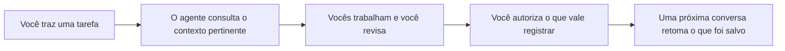

# boonOS 2.1 (beta)

A versão de entrada do boonOS ajuda você a trabalhar melhor com IA: reúne o contexto do seu trabalho para criar, organizar projetos e continuar de onde parou.

## Instale e comece

No computador, abra o **Codex** ou o **Claude Code**, com sua conta conectada e acesso aos arquivos locais. Recomendamos um plano pago básico para trabalhar com mais disponibilidade: ChatGPT Plus para o Codex ou Claude Pro para o Claude Code. O valor varia conforme moeda, impostos e forma de cobrança.

Copie e cole na conversa:

~~~text
Instale o boonOS e me ajude a começar: https://github.com/studio-boon/boonOS
~~~

O agente pode baixar uma cópia do boonOS e iniciar a configuração com perguntas sobre seu trabalho e o que você quer resolver. Você responde à conversa; não precisa saber comandos.

Esse caminho foi verificado em uma sessão do Codex. A experiência e as permissões dependem do agente e do ambiente que você usa.

Se preferir baixar a pasta por conta própria, use a instalação manual abaixo ou siga o [guia de instalação](<06. GUIAS/01. INSTALAÇÃO/INSTALAR.md>).

O boonOS reúne contexto, projetos, memória e skills em uma pasta sua. Você conversa com o agente, traz uma situação real e constrói o sistema a partir dela. Ele pode receber outro nome, acompanhar um profissional independente ou ajudar um pequeno time.

## Como funciona

O boonOS é uma pasta de trabalho que o agente consulta enquanto ajuda você. Ao abrir uma conversa, ele usa o contexto e as fontes pertinentes para entender o pedido. Você acompanha o resultado e pode autorizar o registro de decisões e aprendizados para usar depois.

A memória depende do que foi registrado e do acesso do agente à pasta. Um resumo ajuda a retomar, e as fontes continuam disponíveis para conferência. Entenda a diferença entre [memória e continuidade](<02. MEMORIA/README.md>).

## Duas áreas, um contexto

| Área | Você pode pedir | O que recebe |
|---|---|---|
| **Criativo** | “Preciso apresentar essa ideia”; “me ajuda a melhorar esta peça” | narrativa, texto, direção visual, revisão, conteúdo, sites e cases |
| **Operacional** | “Minha semana está confusa”; “quero entender o caixa deste projeto” | planos, responsáveis, propostas, cenários de preço, contas, conciliação e organização contábil |
| **Base compartilhada** | “Me situa”; “quero parar de repetir esse erro” | contexto preservado, caminhos de trabalho, aprendizado e melhorias verificáveis |

Um projeto tem o mesmo briefing, responsável e histórico nas duas áreas. O pacote inclui **42 skills: 14 criativas, 14 operacionais e 14 compartilhadas**. Você usa as que ajudam no momento; não precisa decorar comandos.

Uma skill orienta um processo. Gerar uma imagem, exportar slides ou conectar um serviço depende das ferramentas disponíveis no seu agente. O núcleo trabalha com conversa e arquivos locais; nenhuma conta externa ou rotina recorrente vem ativada.

## Outras formas de instalar

Baixar o ZIP ou usar Git

**Sem terminal:** baixe `boonOS-2.1-beta.zip` na [release 2.1](https://github.com/studio-boon/boonOS/releases/tag/v2.1.0-beta.4), extraia e abra a pasta no seu agente. O [guia de instalação](<06. GUIAS/01. INSTALAÇÃO/INSTALAR.md>) acompanha cada passo.

**Com Git instalado:** clone esta edição explicitamente:

~~~bash
git clone --branch v2.1.0-beta.4 --single-branch https://github.com/studio-boon/boonOS.git meu-sistema
cd meu-sistema
~~~

O requisito é **um agente de IA capaz de ler e trabalhar nos arquivos da pasta**, com acesso à sua conta nesse agente. Pode ser Codex, Claude Code, Gemini CLI ou outro agente com esse recurso. Você não precisa de uma conta Anthropic para usar o boonOS com outro fornecedor.

Na linha de comando, execute `codex`, `claude` **ou** `gemini` dentro da pasta, conforme o agente instalado. Em um aplicativo que permita abrir uma pasta local, selecione `meu-sistema`. Um chat sem acesso à pasta exige fornecer os arquivos e salvar as saídas manualmente.

Comece com esta mensagem:

> Me guia na configuração deste sistema. Quero entender o que ele pode fazer e começar por um problema real meu. Use a skill local init.

O onboarding oferece dois ritmos: **resolver uma primeira missão** ou **aprofundar a configuração**. Ele pergunta em blocos curtos, mostra possibilidades criativas e operacionais, confirma o que entendeu e registra apenas o contexto autorizado. Você pode pausar e retomar pelo resumo salvo.

O contrato comum é `AGENTS.md`. Codex usa `.agents/skills`; Claude Code entra por `CLAUDE.md` e usa o espelho `.claude/skills`; Gemini CLI entra por `GEMINI.md` e pode descobrir a mesma árvore `.agents/skills`. Em outro agente, peça a leitura do contrato e da skill pelo caminho. A presença desses arquivos não comprova teste em toda versão ou sistema operacional. O [guia de instalação](<06. GUIAS/01. INSTALAÇÃO/INSTALAR.md>) explica como conferir a leitura no seu ambiente.

## Onde cada coisa fica

~~~text
00. TRABALHO/       projetos e entregas em andamento
01. SISTEMA/        contexto, perfil, regras e estado do sistema
02. MEMORIA/        aprendizados e preferências com origem
03. DOCS/           fontes recebidas e índices de documentos
04. GESTÃO/         comercial, financeiro, contabilidade, rotina e fornecedores
05. BIBLIOTECA/     modelos criativos, operacionais e de evolução
06. GUIAS/          instalação, possibilidades e exemplos
99. ARQUIVO/        histórico recuperável do que saiu de uso
~~~

As pastas organizam o uso. `.agents`, `.claude` e `scripts` guardam os recursos técnicos. Crie projetos e registros quando houver conteúdo para eles; o onboarding não precisa preencher todas as áreas.

## O sistema melhora pelo uso

Uma entrega ou dificuldade pode virar um aprendizado, uma proposta de ajuste e um teste. Se o ajuste funciona, ele entra no sistema com origem e histórico. Se piora o resultado, pode ser revertido.

Esse ciclo acontece durante as sessões. Trabalhar entre sessões exige configurar e verificar um executor recorrente. Uma skill de automação ajuda a preparar essa rotina; não a mantém funcionando sozinha.

Para manter o contexto utilizável, `atualizar` compara o que o sistema registra com as fontes atuais, e `compactar-contexto` salva um checkpoint humano em `01. SISTEMA/CONTINUIDADE.md`. Esse checkpoint é portátil entre agentes; ele não substitui a compactação interna da janela de contexto que alguns produtos oferecem.

## Seu contexto continua sendo seu

Use uma cópia privada se for versionar informações pessoais ou de negócio. Guarde documentos confidenciais em um local com acesso adequado e mantenha aqui apenas as referências necessárias. `98. PRIVADO/` e `01. SISTEMA/PRIVADO.md` são destinos locais previstos nas regras de exclusão; antes de colocar conteúdo neles, confirme que o Git os ignora e que não estão rastreados. Exclusão do Git não é proteção de acesso nem remoção de histórico.

O agente respeita autorizações já dadas para a tarefa. Preparar uma proposta, uma mensagem ou um controle local não autoriza enviar, publicar, pagar ou conectar uma conta. Essas ações precisam estar explicitamente incluídas no pedido ou em uma autorização vigente.

## Continue por aqui

- [Comece aqui](<00. COMECE-AQUI.md>): da pasta aberta à primeira missão.
- [O que posso fazer?](<06. GUIAS/02. POSSIBILIDADES/POSSIBILIDADES.md>): quero → trago → recebo.
- [Mapa das 42 skills](<06. GUIAS/02. POSSIBILIDADES/SKILLS.md>): capacidades, entradas e resultados.
- [Personalizar](<06. GUIAS/02. POSSIBILIDADES/PERSONALIZAR.md>): voz, operação e prioridades.
- [Ferramentas e extensões](<06. GUIAS/02. POSSIBILIDADES/MODULOS-FUTUROS.md>): o que depende de configuração.
- [Atualizar uma instalação](<06. GUIAS/01. INSTALAÇÃO/ATUALIZAR.md>): preservar contexto e personalizações.

Para manter o pacote: [publicar uma versão](<06. GUIAS/01. INSTALAÇÃO/PUBLICAR.md>). Esta é a edição **2.1 beta**, identificada como `v2.1.0-beta.4`.
