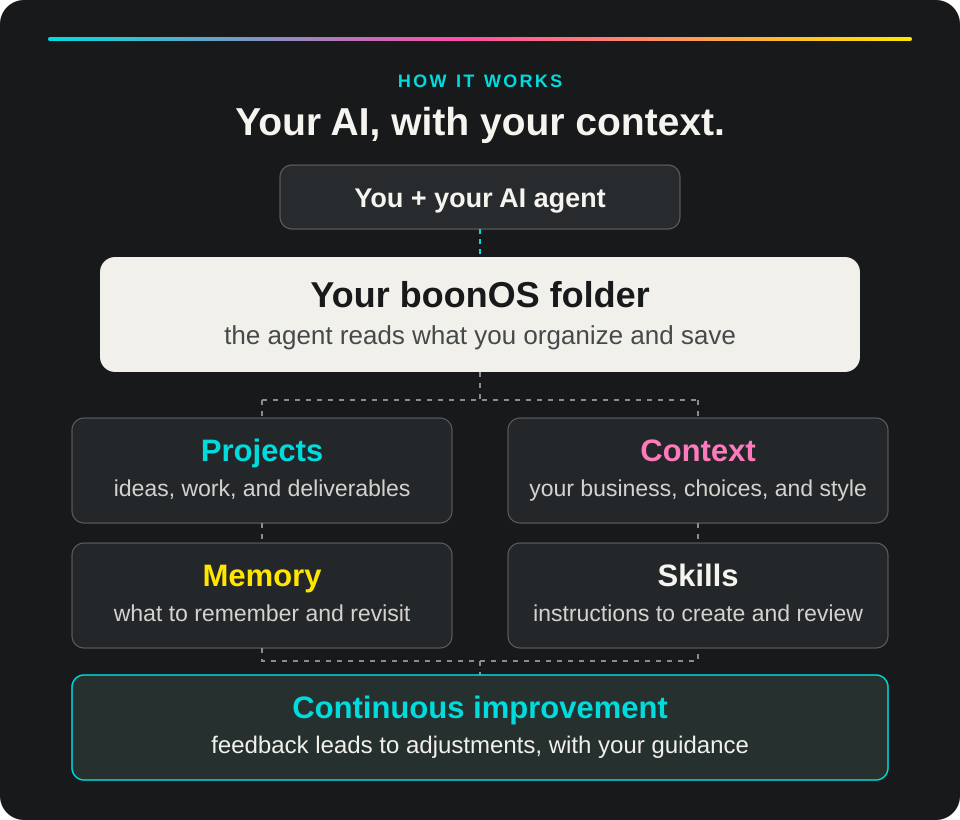

# boonOS Beta

**[Português](README.md) | English**

Your AI knows the task. boonOS helps it get to know **you, your work, and the way you create**.

boonOS brings context, memory, and skills together in a folder you own. Set it up at your own pace, work on real projects, and pick up where you left off with what you've saved. BOON built it around the way we work with AI at the studio.

## Get started

You'll need a computer and an AI agent that can work with files. We recommend **Codex** or **Claude Code**, with a paid plan for greater availability.

Open your agent and paste:

```text
Install boonOS and help me get started in English: https://github.com/studio-boon/boonOS
```

The agent prepares your own copy and starts a conversation about your work. You can begin with a real task or take time to set things up. You don't need to know commands: follow the questions and permissions that appear.

**Already using boonOS?** Open your existing folder and ask the agent to resume. To update without losing your context, follow the [update guide (Portuguese)](<06. GUIAS/01. INSTALAÇÃO/ATUALIZAR.md>).

<details>
<summary>Instructions for the installing agent</summary>

For a new installation, download the [current main branch ZIP](https://github.com/studio-boon/boonOS/archive/main.zip) and extract it to a new location chosen with the user. The ZIP contains an outer repository folder with the `boonOS/` system folder inside it. Open or copy **that inner folder** as the personal workspace. It contains `AGENTS.md` and `boonos.json` at its root. Preserve hidden files and folders, including `.agents` and `.claude`. Use a copy without `.git` and never overwrite an existing installation.

To preserve accented filenames, prefer Python's `zipfile` library for extraction when Python is available. Before announcing completion, run `python3 scripts/check.py --release` from the inner system folder. If extraction or validation fails, do not claim the installation is complete: try again in a new folder, validate and explain any blocker. Tell the person the full path to their personal folder and how to reopen it using their available interface. Check commands before suggesting them; if unsure, say so. In Claude Code via terminal, open a terminal inside the folder and run `claude`, without passing the path as an argument. Then read `AGENTS.md` and use the local `init` skill to start setup. Respect the person's chosen language and save it only with authorization. If they already have a personalized installation, open it and resume its saved context instead of starting over.

</details>

[Prefer manual installation? See the guide (Portuguese).](<06. GUIAS/01. INSTALAÇÃO/INSTALAR.md>)

**Language:** This page and diagram are in English. Most guides, internal instructions, skill files, folder names, and the authoritative license are in Portuguese. The agent can help explain them in English. The same boonOS package is used in either language.

## How it works

<picture>
  <source media="(max-width: 600px)" srcset=".github/assets/boonos-how-it-works-mobile.svg">
  
</picture>

When you work with AI, important things can end up scattered across conversations: who you are, how your brand sounds, what's been decided, and where a project left off. boonOS gives you a place to keep that information and organize your work.

- **Projects:** ideas, materials, decisions, and work in progress.
- **Context:** who you are, how you work, your priorities, and criteria.
- **Memory:** preferences and learnings worth returning to.
- **Skills:** instructions that guide the agent through tasks such as creating, reviewing, and organizing.
- **Improvement:** feedback and learnings can lead to changes in processes and instructions within what you authorize. You can then assess whether the change helped.

You work with AI in your boonOS folder. In your next conversation, open that same folder and ask to continue. Resuming depends on what was saved and the agent's access to those files. [Memory and continuity (Portuguese)](<02. MEMORIA/README.md>) · [How improvement works (Portuguese)](<01. SISTEMA/APRENDIZADO.md>).

### Change AI tools. Keep your context.

If you want to change tools, open the same folder in Codex, Claude Code, or Gemini CLI and continue there. When the application allows it, you can also change the model within the same agent. Your files remain available to read, edit, and take with you.

Before changing, ask the agent to save the decisions and where you left off. In the new conversation, open the folder and ask the agent to read the context and resume. It can only recover what was saved and is accessible; tools, permissions, and results can vary between environments.

### When AI gets it wrong, teach it your way

Did a response feel generic or miss your criteria? Show what didn't work, explain what you prefer, and ask the agent to save the guidance. For example: **“This text feels generic. Next time, start with the client's actual problem and avoid clichés. Save that criterion.”**

When the correction is recorded and consulted in a later task, the agent has a reference to help avoid the same mistake. This does not retrain the model or guarantee it will never make mistakes; you can still review and adjust what was saved.

### Learn as you go

You don't need to know every term to begin. When something is new, ask: **“Explain this with an example from my work.”** The agent can explain as you work together. The [AI at work glossary (Portuguese)](<06. GUIAS/02. POSSIBILIDADES/GLOSSARIO.md>) is there when you want it.

## What can you do?

Bring an idea, a project, or an everyday problem. Talk naturally and refine the result with your AI agent. A few places to start:

- **Develop an idea:** “Help me organize the decisions and next steps to get this project started.”
- **Create content:** “Using what you know about my brand, help me plan and write a post about this.”
- **Review a piece:** “Look at this presentation. What's clear, what's confusing, and what could be better?”
- **Make a website or presentation:** “Organize the message and structure, then help me build it with the tools available.”
- **Create images or videos:** “Help me define the idea, references, and visual direction for this piece.”
- **Build a tool, app, or game:** “Help me organize this idea and build a prototype with the tools available.”
- **Organize projects:** “Show me what's in progress, what remains, and the next step.”
- **Prepare a proposal:** “Use this brief to draft a proposal and show me what still needs deciding.”
- **Understand pricing or cash flow:** “Organize these numbers, show your assumptions, and help me compare scenarios.”
- **Learn and improve:** “What can we take from this reference or feedback to improve how we work?”
- **Repeat a process:** “Turn this way of working into a checklist I can test again.”
- **Resume later:** “Where did we leave this project? What was decided and what remains?”

boonOS guides the agent with available context and skills. Image or video creation, file exports, publishing, service connections, and automation depend on the agent's tools, permissions, and settings. Integrations are not connected by default, and recurring tasks need to be configured.

## Meet the skills

Skills are working instructions that guide tasks with criteria. You don't need to memorize their names: say what you want to do. You can also ask for a skill by name.

The package includes **42 skills**, grouped into creative work, operations, and shared foundations:

<details>
<summary><strong>Creation and communication · 14 skills</strong></summary>

- **`copywriting`:** Write a message with an objective, audience, and supporting evidence.
- **`writing-filter`:** Review the clarity, rhythm, and voice of a text.
- **`brand-storytelling`:** Define a brand or project's narrative, promise, and evidence.
- **`content-strategy`:** Organize topics, formats, and a sustainable publishing rhythm.
- **`carrossel`:** Structure the story, copy, and direction of a carousel.
- **`post-social`:** Plan a social post with a message and visual direction.
- **`design`:** Turn a brief and references into visual direction.
- **`design-review`:** Find readability issues and prioritize changes to a piece.
- **`taste`:** Analyze references and turn taste into selection criteria.
- **`image-direction`:** Define an image's role, composition, and brief.
- **`presentation`:** Organize the story, sequence, and visual plan of a presentation.
- **`site-design`:** Plan the content, sections, and visual direction of a website.
- **`interface-polish`:** Review interface details, states, and interactions.
- **`portfolio-case-study`:** Organize a case study with context, role, decisions, and verified results.

</details>

<details>
<summary><strong>Projects and operations · 14 skills</strong></summary>

- **`boon-projetos`:** Organize deliverables, responsibilities, milestones, and blockers.
- **`boon-rotina`:** Prioritize the week around commitments and capacity.
- **`boon-reunioes`:** Extract decisions, tasks, and open points from supplied notes or transcripts.
- **`boon-clientes`:** Organize a client's context and project handoff.
- **`boon-comercial`:** Understand an opportunity and define the next commercial step.
- **`boon-propostas`:** Structure a proposal with scope, responsibilities, and terms.
- **`boon-precificar`:** Calculate and compare pricing scenarios with explicit assumptions.
- **`boon-contas`:** Record commitments and confirmed payments or receipts.
- **`boon-financeiro`:** Calculate a management view of cash flow, due dates, and forecasts.
- **`boon-conciliar`:** Compare records with a supplied statement and flag differences.
- **`boon-contabilidade`:** Organize documents, missing items, and questions for accounting review.
- **`boon-saude-operacional`:** Connect cash, capacity, and commitments to work decisions.
- **`boon-fornecedores`:** Compare quotes and track agreements with suppliers.
- **`boon-documentos`:** Organize an index of files, versions, and open points.

</details>

<details>
<summary><strong>Context, memory, and evolution · 14 skills</strong></summary>

- **`init`:** Set up your context gradually or resume a paused setup.
- **`overview`:** Review what's recorded and the next step.
- **`router`:** Find a path into a broad request and begin the work.
- **`grill-me`:** Ask questions to clarify an idea or decision.
- **`study-playbook`:** Turn a reference into principles and a practice.
- **`skill-creator`:** Create a skill from a reusable process.
- **`boon-memoria`:** Save a preference, decision, or learning with its source.
- **`atualizar`:** Compare saved context with current sources and flag changes.
- **`compactar-contexto`:** Save a readable checkpoint for later.
- **`boon-melhorar-sistema`:** Propose and test a small improvement based on an observed problem.
- **`boon-avaliar-skills`:** Compare a skill's behavior against defined cases and criteria.
- **`boon-gerir-skills`:** Check the skill set while preserving customizations.
- **`boon-integracoes`:** Plan or configure a needed connection according to access and tools.
- **`boon-automacoes`:** Plan and test a repeatable routine before scheduling it.

</details>

Skills guide the work. Creating specific files, generating images or videos, publishing, connecting services, and scheduling routines depend on the tools and permissions available. Integrations and automations are not connected by default. Local financial calculations and some verification and improvement features require Python 3.10 or later. Financial tools support management; they don't move money or replace review by an accounting professional.

[See the skills map with inputs, outputs, and more detail (Portuguese)](<06. GUIAS/02. POSSIBILIDADES/SKILLS.md>).

## Where things live

boonOS is a folder on your computer. Inside it, each area has a place you and your agent can find:

- [`00. TRABALHO/`](<00. TRABALHO/>): Ongoing projects, research, and deliverables.
- [`01. SISTEMA/`](<01. SISTEMA/>): Context, profile, decisions, catalog, and continuity.
- [`02. MEMORIA/`](<02. MEMORIA/>): Preferences, learnings, and references for later.
- [`03. DOCS/`](<03. DOCS/>): Received sources and document indexes.
- [`04. GESTÃO/`](<04. GESTÃO/>): Commercial, financial, routine, accounting, and supplier records.
- [`05. BIBLIOTECA/`](<05. BIBLIOTECA/>): Creative, operational, and evolution templates.
- [`06. GUIAS/`](<06. GUIAS/>): Installation, possibilities, and examples.
- [`99. ARQUIVO/`](<99. ARQUIVO/>): Completed materials with their origin preserved.
- `AGENTS.md`, `CLAUDE.md`, and `GEMINI.md`: Entry instructions for agents.
- `.agents/skills/` and `.claude/skills/`: Skills and their mirror for different agents. These folders may be hidden on your computer.

You can explore and edit the files, but you don't need to learn the entire structure to start. Tell the agent what you want to do and ask where it saved the work.

## Your context belongs to you

The recommended installation creates a personal copy without Git history. Your folder may contain information about you and your business: choose where to store it and who can access it. Your agent and AI services may process files according to their settings and policies.

If you use Git, take care before sending changes: some context files are tracked in the repository. Adding a `.gitignore` rule alone does not stop tracking them. A clone doesn't publish data by itself, but a later push to a public repository can expose it. Never put passwords or keys in your context.

## Keep exploring

The following guides are in Portuguese:

- [Start here](<00. COMECE-AQUI.md>): from the first conversation to your first mission.
- [What you can do](<06. GUIAS/02. POSSIBILIDADES/POSSIBILIDADES.md>): more ideas for prompts and results.
- [Personalize](<06. GUIAS/02. POSSIBILIDADES/PERSONALIZAR.md>): voice, operations, and priorities.
- [Tools and extensions](<06. GUIAS/02. POSSIBILIDADES/MODULOS-FUTUROS.md>): what needs additional configuration.
- [Installation and updates](<06. GUIAS/01. INSTALAÇÃO/INSTALAR.md>): options and care for your copy.
- [History and transparency](<06. GUIAS/04. HISTÓRICO E TRANSPARÊNCIA/README.md>): versions, validation, origin, and rights.

boonOS is in beta and keeps evolving. Try it with a project, tell us how it went, and leave a GitHub star if you like it. To hear when the community's first cohort opens, join the list at [boonos.tech](https://boonos.tech).

Copyright © 2026 Studio BOON. All rights reserved. The [terms of use](LICENSE.md) are authoritative in Portuguese. In brief, Studio BOON permits downloading, use, and modification of its own boonOS materials for personal and professional use. Redistribution, republication, sublicensing, or sale of the boonOS materials or modified versions requires prior express authorization, subject to rights granted by the hosting platform. Third-party materials remain subject to their own terms; see [third-party notices (Portuguese)](<06. GUIAS/04. HISTÓRICO E TRANSPARÊNCIA/TERCEIROS.md>) and [provenance (Portuguese)](PROVENIENCIA.md).
